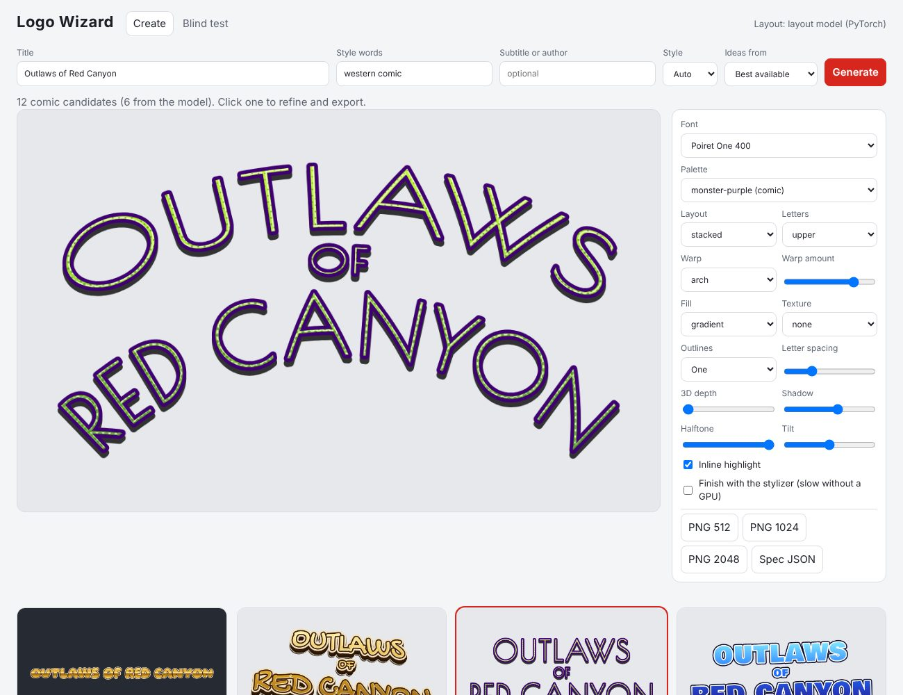

# Logo Wizard

Create comic-book and novel-cover title logos on your Windows PC. Logo Wizard draws letters from font outlines and combines them with warps, outlines, shadows, extrusion, gradients, halftone and texture effects. Export a transparent PNG or save the design as JSON.

**The Windows app works immediately with its procedural title rules. No trained models are bundled or required.** Optional models can suggest layouts and add a diffusion finish after you train and export them separately.

[Download for Windows](https://github.com/OpenAnimationLibrary/logowizard/releases) · [Installation and training](INSTALL.md) · [Changelog](CHANGELOG.md) · [Credits](CREDITS.md)

## Run the Windows app

1. Download `LogoWizard-0.1.0-win64.zip` from the [releases page](https://github.com/OpenAnimationLibrary/logowizard/releases).
2. Extract the whole ZIP, open the extracted `LogoWizard` folder, and double-click `LogoWizard.exe`. Keep the accompanying files and folders together.
3. The app opens in your browser at `http://127.0.0.1:8765`, or the next available port. Close its console window to stop it.

The ZIP needs no installation, Python environment or separate font download. An optional `LogoWizard-0.1.0-setup.exe` installs the same app for your Windows user and adds Start menu entries. See [INSTALL.md](INSTALL.md) for both options.

## Make a logo

Enter a title, optional subtitle, and style words such as `western comic`, `gothic novel` or `science fiction`. Generate candidates, select one, and refine its font, palette, arrangement, warp, outlines, shadow and other effects. Export PNG at 512, 1024 or 2048 pixels wide, or save the design specification as JSON.

The procedural renderer works on CPU. It uses HarfBuzz for text shaping and Skia for drawing, with a curated Google Fonts catalog. Logo rendering and feedback stay on your PC.



## Optional models

The source includes tools to build a synthetic dataset and train two models:

- A **layout model** chooses a design specification: fonts, colors, arrangement and effects.
- A **stylizer** adds a diffusion finish conditioned on the lettering and design. Its default training resolution is 128 × 80 pixels, then the result is upscaled for export.

The Windows release includes an ONNX Runtime CPU backend for exported models. It does not include PyTorch, training tools or trained weights. Follow [INSTALL.md](INSTALL.md) to train models in a source checkout and copy their ONNX files and JSON configuration into the app's model folder. Model quality depends on training; use the comparison and evaluation tools to assess your results.

Thumbs up/down, exports and Blind test choices are recorded locally. Fine-tuning is an explicit step in the training checkout; collecting feedback alone does not update a model.

## Run from source

Install Python 3.11 and Git, then run these commands in PowerShell:

```powershell
git clone https://github.com/OpenAnimationLibrary/logowizard.git
cd logowizard
py -3.11 -m venv .venv
.\.venv\Scripts\python.exe -m pip install -e ".[app]"
.\.venv\Scripts\logo-wizard-fonts.exe
.\.venv\Scripts\logo-wizard-app.exe
```

The font download requires internet access. The repository already includes the text corpus and palette data used by the procedural generator. To rebuild the corpus from its recorded sources, run `.\.venv\Scripts\logo-wizard-corpus.exe`.

Source runs keep downloaded fonts, generated data, models and feedback in the ignored `local/` directory. The packaged Windows app keeps models and feedback in `%LOCALAPPDATA%\LogoWizard`. Set `LOGO_WIZARD_HOME` to choose another location; [INSTALL.md](INSTALL.md) explains the directory layout.

## Project and licenses

This is the independently hosted [Open Animation Library edition](https://github.com/OpenAnimationLibrary/logowizard), based on Rodney Baker's Logo Wizard with Claude-assisted development. [CREDITS.md](CREDITS.md) records the exact application and packaging source revisions.

Project code is distributed under the [BSD 3-Clause license](LICENSE). Fonts and text sources retain their respective terms and attribution; see [DATA_LICENSES.md](DATA_LICENSES.md). The local [design plan](docs/design-plan.md) describes the architecture and development goals.
